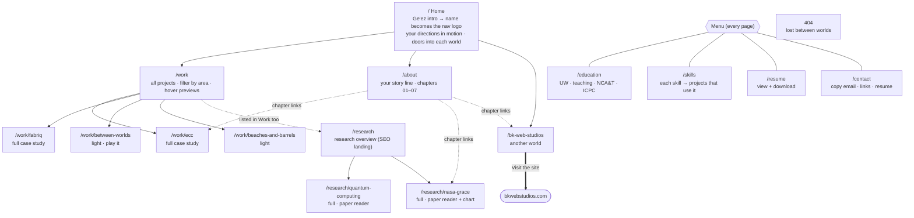

# Step 0.3: Site map

Every page, what's on it, and how pages connect. This covers structure only. Look and motion come in Phase 1.

## Diagram

## On every page

- **Logo:** your name, which shrank out of the intro. ብሩኽ becomes the monogram (also the favicon).
- **Menu button:** always visible. The menu uses **different sizes and weights**:
  - Big: Work, About, BK Web Studios, Contact
  - Medium: Research
  - Smaller: Education, Skills, Resume
  - Hovering a link previews that page. On phones, the previews show as you tap through.
- **Sound toggle** and, on Home, **skip intro**.
- **Footer:** giant sign-off, click-to-copy email, resume, LinkedIn and GitHub. **No "book a call" on the portfolio.**
- **Light ↔ dark** shifts as you scroll. The menu has a manual switch too.

## Pages

| Page | What's on it | Connects to |
| --- | --- | --- |
| **/** Home | Ge'ez intro (every visit, 2–4 s, skippable) → name flies into the nav → a motion piece showing your directions (Salesforce, full stack, data and research) → doors into Work, About, BKWS | Work, About, BKWS |
| **/about** | Your story as a line: 01 Asmara → 02 Running Start → 03 advisors say switch → 04 the leap: math + CS → 05 nonprofits (ECC) → 06 BK Web Studios → 07 the glitchy unknown (with a hidden OutTheGC easter egg). Photos and images per chapter, stats, small details (Seahawks, superheroes, Eritrea), a map of places. | Chapters link to ECC, NASA GRACE, BKWS |
| **/work** | All 6 projects, filterable by area (Salesforce, Full stack, Research), with hover previews. Full case studies are marked as such. The two research projects link to their /research pages. | Each project page, /research |
| **/work/ecc** | Full case study: the nonprofit, the problem, "built it twice" (ECCManager → Salesforce), the 8-stage lifecycle, impact. Demo video. | Next project, About ch. 05 |
| **/work/fabriq** | Full case study: hackathon, team of 4, AI outfits, what's next (FabriqAWS). Live demo + demo login. | Next project |
| **/work/between-worlds** | Light: what it is, poster and sprites, a "play it" link. | Next project |
| **/work/beaches-and-barrels** | Light: what it is, screenshots, repo link. | Next project |
| **/research** | The SEO landing for your research: a short intro to your research interests (quantum computing, climate data science), both papers with abstracts, co-authors and advisors, and links into each. | Both research pages, Education |
| **/research/quantum-computing** | Full: the paper explained visually, plus a paper reader. Co-authors and advisor credited. | /research, Work |
| **/research/nasa-grace** | Full: the research, an interactive data chart, plus a paper reader. NCA&T summer. Co-authors and mentors credited. | /research, Work, About |
| **/bk-web-studios** | The world swap. What BKWS is and does, client sites in device mockups (**not linked**), and a big "Visit the site" button. | bkwebstudios.com |
| **/education** | UW, double major CS + Math, Dean's List, GPA, graduated June 2026. Course facilitator, NCA&T research program, ICPC. | /research |
| **/skills** | Skill groups. Each skill shows which projects used it. | Project pages |
| **/resume** | Resume shown in the page, plus a download. | |
| **/contact** | Copy email, LinkedIn, GitHub, resume. | |
| **404** | A small glitch page that sends people home. | Home |

## SEO note

Each research paper has **one** home, at `/research/...`. The Work page lists them but links there instead of duplicating the page. That way search engines see one strong page per paper, not two competing copies.

## Decisions (2026-11-24)

1. **A separate /research page**, for SEO. The papers live under /research and are also listed in Work.
2. **Menu items in different sizes and weights**, as listed above.
3. **No "book a call" anywhere on the portfolio.**
4. Teaching, NCA&T and ICPC can appear in **both** Education and the story.
